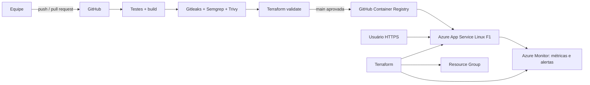

# ZelaCidade — Global Solution FIAP 2026.2

> Bruno Venturi Lopes Vieira — RM 99431  
> Guilherme Alves de Lima — RM 550433  
> Leonardo de Oliveira Ruiz — RM 98901

Infraestrutura e pipeline DevSecOps da plataforma colaborativa ZelaCidade.

## Estado atual

A infraestrutura de produção está criada no Azure por Terraform, o pipeline está funcional e o monitoramento está ativo. A URL pública abaixo usa um frontend provisório somente para validar o deploy. **O MVP oficial da equipe ainda será conectado antes da entrega final.**

- Aplicação provisória: <https://app-zelacidade-gs-99431.azurewebsites.net>
- Repositório público: <https://github.com/brunoventuri01/zelacidade>
- Pipeline de produção validado: <https://github.com/brunoventuri01/zelacidade/actions/runs/42635724419>

## Arquitetura



Detalhes e responsabilidades: [`docs/ARCHITECTURE.md`](docs/ARCHITECTURE.md).

## Infraestrutura como código

`terraform-azure/` cria:

- Resource Group `rg-zelacidade-gs-99431`;
- App Service Plan Linux F1;
- Web App em container com HTTPS obrigatório;
- autenticação básica de FTP e WebDeploy desabilitada;
- alerta operacional de HTTP 5xx;
- alerta controlado para evidência do monitoramento.

O state, planos, `tfvars` e credenciais não são versionados. O deploy altera somente a imagem do container; o Terraform ignora essa propriedade para não desfazer uma versão publicada pelo CI/CD.

## Pipeline DevSecOps

`.github/workflows/ci.yml` roda em cada push e pull request:

1. testes, validação do Compose e build dos containers;
2. Gitleaks para segredos;
3. Semgrep para análise estática;
4. Trivy para vulnerabilidades HIGH/CRITICAL;
5. `terraform fmt` e `terraform validate`;
6. na `main`, build/push da imagem no GHCR e deploy automático no Azure;
7. smoke test HTTPS da URL pública.

Evidência controlada: a execução [42637898515](https://github.com/brunoventuri01/zelacidade/actions/runs/42637898515) foi barrada por um segredo sintético. Após a correção, a execução [42638080332](https://github.com/brunoventuri01/zelacidade/actions/runs/42638080332) passou.

## Observabilidade

O Azure Monitor coleta métricas nativas do App Service: tráfego, respostas HTTP 2xx/4xx/5xx, tempo de resposta, CPU e memória. O Terraform mantém dois alertas:

- `alert-zelacidade-http5xx`: mais de cinco erros 5xx em cinco minutos;
- `alert-zelacidade-traffic-evidence`: limite baixo usado no teste controlado.

## Como reproduzir

Pré-requisitos: Terraform 1.17+, Azure CLI autenticada e uma assinatura compatível.

```bash
cd terraform-azure
terraform init
terraform fmt -check
terraform validate
terraform plan -var="subscription_id=<ID_DA_ASSINATURA>"
```

O `apply` deve ser executado apenas pelo responsável pela assinatura. O deploy da aplicação ocorre pela pipeline, usando `AZURE_CREDENTIALS` nos GitHub Secrets.

## Ficha técnica

| Item | Situação |
|---|---|
| Nuvem | Microsoft Azure — assinatura FIAP Students Starter |
| Execução | Azure App Service Linux F1 em container |
| IaC | Terraform com provider AzureRM |
| Registry | GitHub Container Registry |
| CI/CD | GitHub Actions |
| Segurança | Gitleaks, Semgrep, Trivy e secrets do GitHub |
| Observabilidade | Azure Monitor e alertas de métrica |
| HTTPS | Obrigatório no App Service |
| MVP oficial | **Pendente de integração pela equipe** |

## Documentos

- [`docs/EVIDENCE.md`](docs/EVIDENCE.md): evidências verificáveis e pendências;
- [`docs/SECURITY.md`](docs/SECURITY.md): segurança, LGPD e responsabilidade compartilhada;
- [`docs/COSTS.md`](docs/COSTS.md): estimativa de custos;
- [`docs/MVP-INTEGRATION.md`](docs/MVP-INTEGRATION.md): checklist para receber o MVP oficial.

