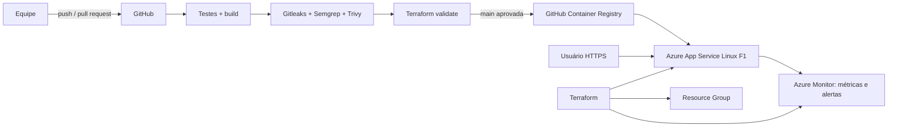

# ZelaCidade — Global Solution FIAP 2026.2

> Bruno Venturi Lopes Vieira — RM 99431  
> Guilherme Alves de Lima — RM 550433  
> Leonardo de Oliveira Ruiz — RM 98901

Plataforma colaborativa para identificar, organizar e acompanhar problemas em espaços públicos: o morador registra com foto e local, a IA de visão sugere a categoria, um robô faz a triagem e a organização responsável só marca como resolvido com foto da solução.

## Estado atual

A infraestrutura de produção está criada no Azure por Terraform, o pipeline está funcional e o monitoramento está ativo. A URL pública serve o MVP oficial: um único container com a API FastAPI e o site React, na porta 8000, usando Postgres no Neon.

- MVP: <https://app-zelacidade-gs-99431.azurewebsites.net>
- Repositório público: <https://github.com/brunoventuri01/zelacidade>
- Pipeline de produção validado: <https://github.com/brunoventuri01/zelacidade/actions/runs/42635724419>

## MVP: como rodar no PC

Pré-requisito: Docker com Compose.

```bash
cp .env.example .env          # troque os CHANGE_ME por valores locais
docker compose up --build     # sobe db (Postgres) + app em http://localhost:8000
docker compose exec app python -m app.seed --quantidade 200 --semente 42 --limpar   # dados simulados
```

Testes:

```bash
pip install -r backend/requirements-dev.txt
PYTHONPATH=backend pytest -q backend/tests
cd frontend && npm ci && npm test && npm run build
```

Desenvolvimento do site com recarga automática: rode a API (`DATABASE_URL=sqlite:///./local.db uvicorn app.main:app --app-dir backend`) e, em outro terminal, `cd frontend && npm run dev`.

### Estrutura

| Caminho | Conteúdo |
|---|---|
| `Dockerfile` | Imagem única: build do React → Python 3.12 slim, usuário não root, porta 8000, `HEALTHCHECK` em `/health` |
| `backend/app/` | API FastAPI, modelos SQLAlchemy, visão (ONNX), assistente, gerador de dados simulados |
| `backend/app/data/area_piloto.json` | Área piloto (centro, limites e bairros) em um só arquivo |
| `backend/models/visao/` | `best.onnx` e `classes.json` do modelo de visão |
| `backend/tests/` | Testes de contrato, LGPD e decodificação do YOLO |
| `frontend/` | Site React (Vite): mapa, registro, detalhe, painel, assistente, gestão e privacidade |

### Contratos da API

A documentação interativa fica em `/docs`. Resumo:

| Quem chama | Endpoint | Autenticação |
|---|---|---|
| Site | `GET /api/v1/config`, `GET/POST /api/v1/ocorrencias`, `GET /api/v1/ocorrencias/{id}`, `POST /api/v1/ocorrencias/{id}/confirmacoes`, `GET /api/v1/fotos/{id}`, `POST /api/v1/ia/classificar`, `GET /api/v1/painel`, `POST /api/v1/assistente` | pública |
| Organização (gestão) | `GET /api/v1/gestao/ocorrencias`, `PATCH /api/v1/gestao/ocorrencias/{id}` | `Authorization: Bearer ADMIN_TOKEN` |
| Robô Maker Lab | `POST /api/v1/robot/occurrences` (resposta traz `protocolo` para o LCD) | `X-API-Key: ROBOT_API_KEY` |
| Robô RPA | `GET /api/v1/integracao/ocorrencias`, `PATCH /api/v1/integracao/ocorrencias/{id}/triagem`, `POST /api/v1/integracao/painel` | `X-API-Key: RPA_API_KEY` |
| Airflow (Big Data) | `GET /api/v1/export/ocorrencias?data=AAAA-MM-DD` (NDJSON) | `X-API-Key: EXPORT_API_KEY` |
| Operação | `GET /health`, `GET /metrics` | pública |

### Segurança e LGPD no MVP

- Credenciais só por variável de ambiente; `CHANGE_ME` ou vazio desliga a integração (HTTP 503).
- Fotos reduzidas para até 1280 px e regravadas sem EXIF (que pode conter GPS e aparelho).
- E-mail só com consentimento e nunca nas rotas públicas; o identificador do aparelho é guardado como hash.
- Cabeçalhos de segurança (CSP, `nosniff`, `Referrer-Policy`) e upload limitado a JPEG/PNG/WEBP de até 5 MB.
- Dados simulados têm `simulado=true`, selo na tela e filtro; a geração está documentada em `backend/app/seed.py`.

## Arquitetura



Detalhes e responsabilidades: [`docs/ARCHITECTURE.md`](docs/ARCHITECTURE.md).

## Infraestrutura como código

`terraform-azure/` cria:

- Resource Group `rg-zelacidade-gs-99431`;
- App Service Plan Linux F1;
- Web App em container com HTTPS obrigatório;
- autenticação básica de FTP e WebDeploy desabilitada;
- alerta operacional de HTTP 5xx;
- alerta controlado para evidência do monitoramento.

O state, planos, `tfvars` e credenciais não são versionados. O deploy altera somente a imagem do container; o Terraform ignora essa propriedade para não desfazer uma versão publicada pelo CI/CD.

## Pipeline DevSecOps

`.github/workflows/ci.yml` roda em cada push e pull request:

1. testes, validação do Compose e build dos containers;
2. Gitleaks para segredos;
3. Semgrep para análise estática;
4. Trivy para vulnerabilidades HIGH/CRITICAL;
5. `terraform fmt` e `terraform validate`;
6. na `main`, build/push da imagem no GHCR e deploy automático no Azure;
7. smoke test HTTPS da URL pública.

Evidência controlada: a execução [42637898515](https://github.com/brunoventuri01/zelacidade/actions/runs/42637898515) foi barrada por um segredo sintético. Após a correção, a execução [42638080332](https://github.com/brunoventuri01/zelacidade/actions/runs/42638080332) passou.

## Observabilidade

O Azure Monitor coleta métricas nativas do App Service: tráfego, respostas HTTP 2xx/4xx/5xx, tempo de resposta, CPU e memória. O Terraform mantém dois alertas:

- `alert-zelacidade-http5xx`: mais de cinco erros 5xx em cinco minutos;
- `alert-zelacidade-traffic-evidence`: limite baixo usado no teste controlado.

## Como reproduzir

Pré-requisitos: Terraform 1.17+, Azure CLI autenticada e uma assinatura compatível.

```bash
cd terraform-azure
terraform init
terraform fmt -check
terraform validate
terraform plan -var="subscription_id=<ID_DA_ASSINATURA>"
```

O `apply` deve ser executado apenas pelo responsável pela assinatura. O deploy da aplicação ocorre pela pipeline, usando `AZURE_CREDENTIALS` nos GitHub Secrets.

## Ficha técnica

| Item | Situação |
|---|---|
| Nuvem | Microsoft Azure — assinatura FIAP Students Starter |
| Execução | Azure App Service Linux F1 em container |
| IaC | Terraform com provider AzureRM |
| Registry | GitHub Container Registry |
| CI/CD | GitHub Actions |
| Segurança | Gitleaks, Semgrep, Trivy e secrets do GitHub |
| Observabilidade | Azure Monitor e alertas de métrica |
| HTTPS | Obrigatório no App Service |
| MVP oficial | FastAPI + React em container único (porta 8000), Postgres no Neon |

## Documentos

- [`docs/EVIDENCE.md`](docs/EVIDENCE.md): evidências verificáveis e pendências;
- [`docs/SECURITY.md`](docs/SECURITY.md): segurança, LGPD e responsabilidade compartilhada;
- [`docs/COSTS.md`](docs/COSTS.md): estimativa de custos;
- [`docs/MVP-INTEGRATION.md`](docs/MVP-INTEGRATION.md): checklist para receber o MVP oficial.

