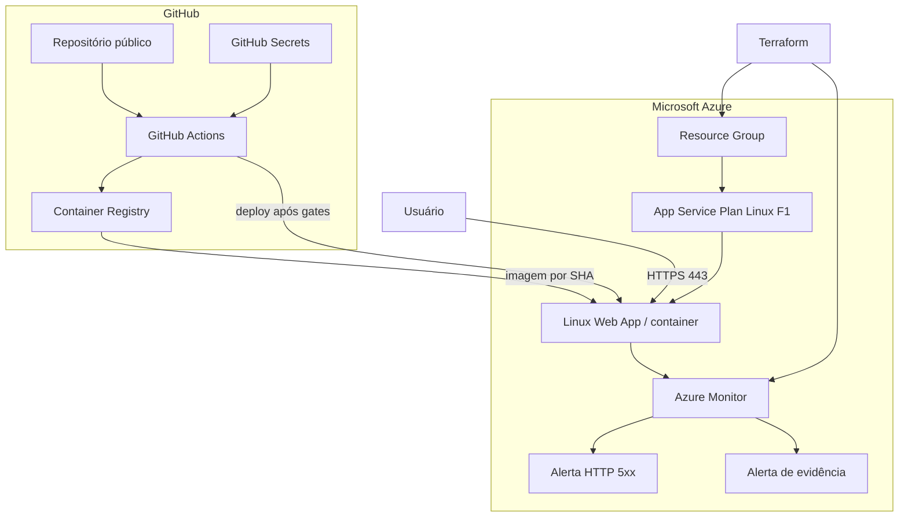

# Arquitetura de produção

## Fluxo de entrega

1. A equipe envia código para o GitHub.
2. Testes, build e quatro gates técnicos são executados.
3. Qualquer falha interrompe o fluxo antes do deploy.
4. Na `main`, a imagem recebe a tag do SHA e é publicada no GHCR.
5. A pipeline autentica no Azure com credencial restrita ao Web App.
6. O App Service troca a imagem, reinicia e recebe um smoke test HTTPS.
7. O Azure Monitor coleta as métricas e avalia os alertas.

## Limite atual

O App Service serve um frontend provisório para validar todo o caminho de produção. A infraestrutura não pressupõe a implementação do MVP; a imagem oficial será integrada quando a equipe responsável entregá-la.

